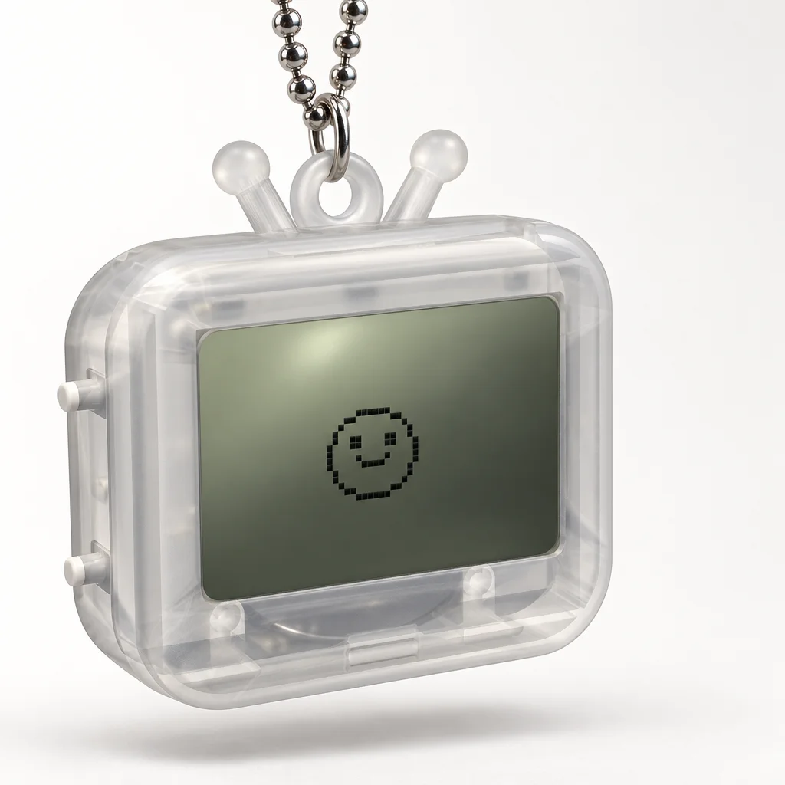
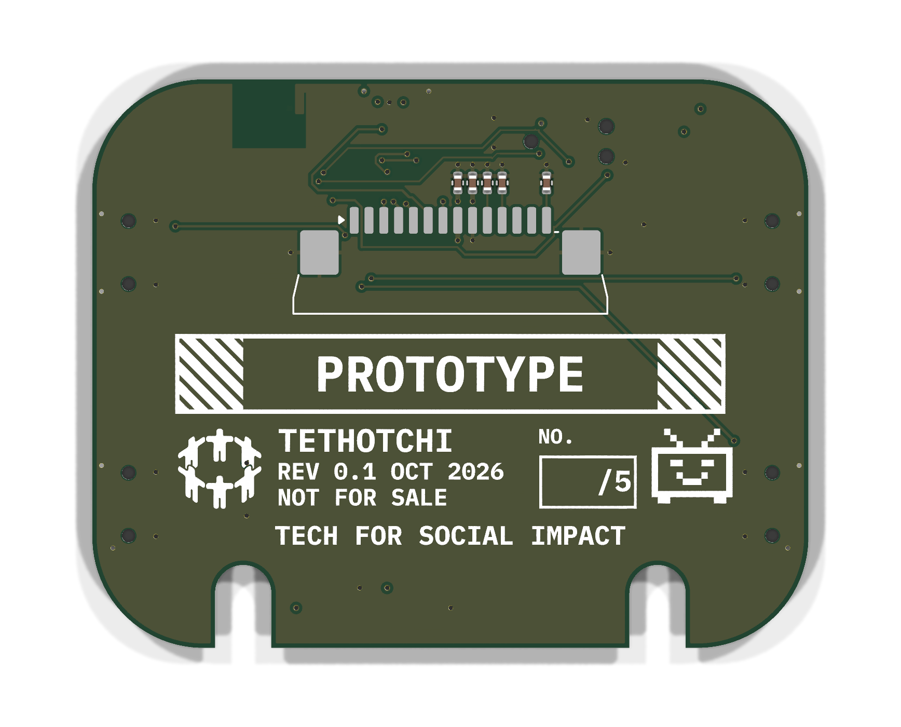
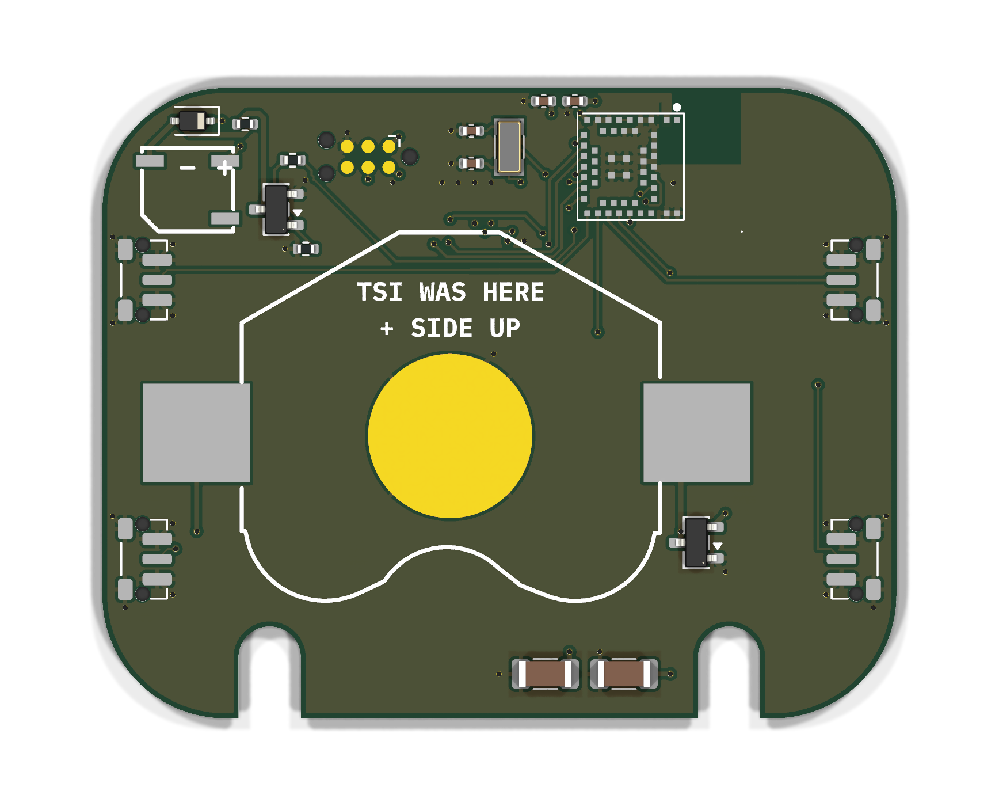
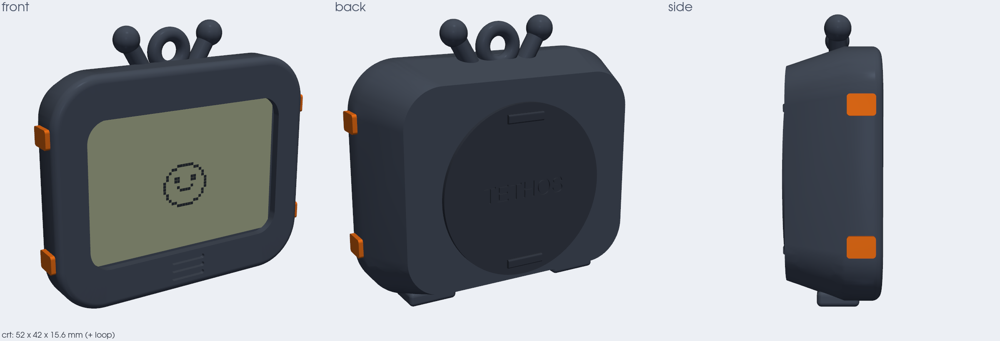
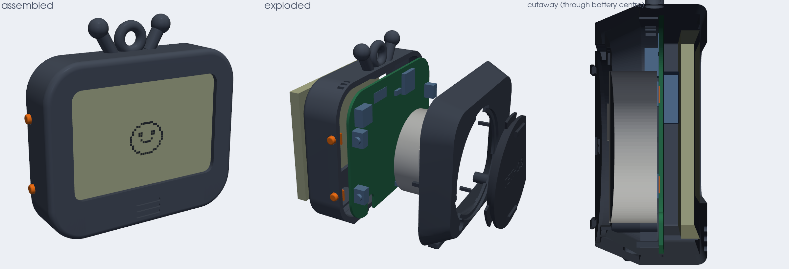
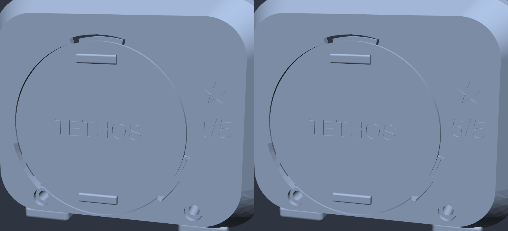

# Tethotchi

A virtual pet keychain shaped like a tiny CRT TV. Made by [Tethos](https://tethos.ca) / Tech for Social Impact as merch: you feed it, it grows, it visits other Tethotchis over Bluetooth, and it dies if you forget about it.



<sub>Product render generated from the CAD in this repo (GPT Image 2). Real units are still being built.</sub>

## Specs

| | |
|---|---|
| Size | 52 x 42 x 18.1 mm, plus antennas and ball-chain loop |
| Screen | 1.7" 128x64 monochrome FSTN (ST7567) |
| Brain + radio | u-blox ANNA-B112 (nRF52832, certified BLE module with built-in antenna) |
| Power | CR2477 coin cell behind a twist-lock cap, 6-12 month target |
| Input / output | 4 side buttons, magnetic buzzer |
| Talks to | other Tethotchis (pet visits), event beacons, a web page (sync + firmware updates over Web Bluetooth) |
| Cost | ~$19-23 per unit at 100 units |

## What's in here

```
hardware/
  layout.py, circuit.py     single source of truth: placement, dimensions, every pin's net
  pcb/                      KiCad 10 board, generated by script; JLC fab files in pcb/fab/
  shell/                    build123d CAD for the case; STEP/STL in shell/out/
  art/                      silkscreen art generator (Plex Mono, Tethos mark, pixel TV)
  renders/                  board, shell and fit-check renders
  parts.md                  BOM with LCSC numbers and costs
  ORDER.md                  what to order where for the first 5
firmware/                   Zephyr / nRF Connect SDK (early scaffold)
web/                        Web Bluetooth updater (vendored mcumgr-web)
```

The board and the case are both code. Change `layout.py`, rerun the pipeline in [hardware/README.md](hardware/README.md), and the PCB, shell, collision check and factory files all follow.

## Board

4 layers, 48.4 x 38.4 mm, 0.8 mm thick, assembled by JLCPCB. The screen side carries the art; the battery side carries everything else.

| Screen side | Battery side |
|---|---|
|  |  |

## Case




Two halves that close with two M1.7 screws, a twist-lock battery cap (printed in three tolerances to pick the best fit), and button plungers printed on a sprue. The first run of five has numbered backs, ★ 1/5 to ★ 5/5.




## Status

- [x] Hardware spec, BOM, shell v0.1, PCB routed (KiCad DRC clean), fab files
- [ ] First 5 units ordered and assembled
- [ ] Firmware: pet loop, BLE visits, web sync, OTA
- [ ] 100-unit run

Not affiliated with Bandai. Tamagotchi is their trademark; this is a fan homage with its own body, mascot and code.
